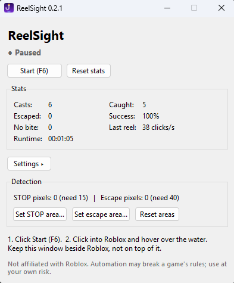

# ReelSight

A small Windows tool that automates the click-to-cast, click-fast fishing minigame in the Roblox game *Steal an Egg*. It reads your screen for the reel UI and sends mouse clicks. It runs outside Roblox.

**[Download the latest ReelSight release](https://github.com/SeannyBoyyy/reelsight/releases/latest)**



> **Not affiliated with Roblox Corporation or the developers of *Steal an Egg*.** "Roblox" is a trademark of Roblox Corporation.

## Read this first

- **It may break a game's rules.** Roblox and individual game developers can ban accounts for automation, and enforcement varies. ReelSight does not inject code, read game memory or use an executor, but that does not guarantee you are safe. Use it at your own risk, ideally on an alt account.
- **Roblox must stay visible and focused.** It captures the screen and clicks where your cursor is. A minimized or covered window can't be read.
- **It is tuned to one game's UI** (as of November 2026). If the developers change the fishing UI, detection may stop working until you re-pick the detection areas.

## How it works

1. Holds the mouse button briefly to cast.
2. Watches a small area for the red **STOP** button that appears while a fish is biting.
3. While STOP is visible, clicks rapidly (around 40 clicks per second on the author's PC).
4. Looks for the red **"It got away..."** text to count escapes. "Caught" means no escape text was seen, so the success rate is an estimate.
5. Repeats.

It only touches your screen and mouse. It does not talk to the game or the network.

**Safety zone.** It only clicks while your cursor is over the water (the middle of the Roblox window by default). This keeps clicks off Shop, Index, the hotbar and the STOP button itself. If the cursor leaves that zone or Roblox loses focus, it stops clicking and waits.

## Requirements

- Windows 10 or 11
- Python 3.10 or newer (the window app uses `tkinter`, which comes with the standard Windows installer)
- Roblox in windowed or borderless mode, visible on screen (exclusive fullscreen may block screen capture; untested)

## Setup

```powershell
git clone https://github.com/SeannyBoyyy/reelsight.git
cd reelsight
python -m pip install -r requirements.txt
```

## Window app (recommended)

```powershell
python app.py
```

1. Click **Start** (or press the start/pause hotkey, **F6** by default).
2. Click into Roblox and hover over the water.
3. It casts, reels and repeats. The hotkey pauses and resumes.

To change the hotkey, open **Settings**, click **Change...** and press the key you want. **Esc** cancels. Almost any single key works, including letters, digits, the numpad and the arrow keys. These are not allowed: **F7** (it only quits the terminal version; the window app ignores it), **F8** (area picker), Esc, and Shift, Ctrl, Alt and Windows. Combinations such as Ctrl+F6 are not supported.

Keys that type a character or move your character (letters, digits, Space, arrows and so on) are allowed, but ReelSight asks you to confirm, because they will start or pause the app whenever you press them, including while you chat. F6, Insert, Delete, Home, End and Page Up/Down are safer choices. Roblox reserves keys such as F9 and F11 for its developer console and fullscreen controls, so ReelSight asks for confirmation before using them.

Keep the ReelSight window beside Roblox, not on top of it, or it will cover the area being scanned.

The window shows live stats (casts, caught, escaped, success rate, click speed, runtime), editable settings, and a live detection readout.

### Set the detection areas

If the STOP button is never detected (for example on a different screen size or window layout), pick the area yourself:

1. Click **Set STOP area...**.
2. In Roblox, cast a line and wait until the STOP button is on screen.
3. Press **F8**. ReelSight freezes a screenshot of the game.
4. Drag a box tightly around the STOP button and click **Save**.

ReelSight also sets the minimum pixel threshold from what it finds in your box. Do the same with **Set escape area...** for the "It got away..." text. That text only shows for about two seconds, so press F8 right after a fish escapes.

**Reset areas** restores the defaults.

Settings from the window are saved to `%APPDATA%\ReelSight\config.json`.

## Terminal version

```powershell
python reelsight.py
```

Same engine, no window. The start/pause hotkey (`toggle_hotkey`, **F6** by default) starts and pauses, and **F7** quits. F7 works only in the terminal version; the window app ignores it. Settings are in `config.json` next to the script, created on first run.

To check detection without clicking:

```powershell
python reelsight.py test
```

`STOP red` should jump when the STOP button appears, and `escape text` should jump when "It got away..." appears.

## Build a standalone .exe

```powershell
python -m pip install -r requirements-dev.txt
python -m PyInstaller --onefile --noconsole --name ReelSight --icon assets\reelsight.ico --add-data "assets\reelsight.ico;assets" app.py
```

The result is `dist\ReelSight.exe`. Antivirus programs sometimes flag PyInstaller apps that send mouse clicks. That is a false positive, but you may need to allow it. The exe is Windows only.

## Settings

| Setting | Default | Meaning |
|---|---|---|
| `window_title` | `Roblox` | Title of the window to watch. |
| `cast_hold` | `0.15` | Seconds to hold the mouse button when casting. |
| `bite_timeout` | `20` | Seconds to wait for a bite before recasting. |
| `click_interval` | `0.02` | Seconds between clicks while reeling. |
| `reel_timeout` | `25` | Maximum seconds of reeling per fish. |
| `after_catch_delay` | `4` | Seconds to wait after a catch for the popup to clear. |
| `min_red_pixels` | `15` | Red pixels needed to count the STOP button as visible. |
| `scan_step` | `4` | Pixels skipped when scanning. Higher is faster but less precise. |
| `area` | see file | STOP button area, as fractions of the Roblox window. |
| `escape_area` | see file | "It got away..." text area, as fractions of the Roblox window. |
| `escape_min_pixels` | `40` | Pixels needed to count the escape text as visible. |
| `escape_watch` | `3.0` | Seconds to look for the escape text after reeling. It counts toward `after_catch_delay`, so it is also the shortest wait after a catch. Lower it to recast faster; if it is too short, escapes that show up late are counted as catches. |
| `require_focus` | `true` | Only act while Roblox is the active window. |
| `toggle_hotkey` | `F6` | Start/pause key, by name: `F9`, `Insert`, `Num 5`, `Q`, and so on. F7 and F8 are reserved. An invalid name falls back to `F6`. |
| `safe_zone` | see file | The cursor must stay in this part of the window for clicks to be sent. |

## Tuning

- **Fish keep escaping.** Check "Last reel" for the click speed. If it is low, lower `click_interval`. If it is high but fish still escape, try raising it to about `0.04`, since some games drop clicks that come too fast.
- **Never detects STOP.** Use **Set STOP area...** (see above). `python pick_color.py` is also available: hover over a spot to read its position and color.
- **Stuck on "Waiting".** Click into Roblox and move the cursor into the middle of the window. Widen `safe_zone` if needed.
- **Many "no bite" results.** Raise `bite_timeout`, or make sure the cast lands in water.

## Limitations

- Windows only (uses the Win32 API).
- Not tested on multiple monitors with different scaling.
- The success rate is an estimate.
- Works only while Roblox is visible and focused.

## Disclaimer

This project is provided as is, with no warranty. You are responsible for following the rules of Roblox and of any game you use it with. The author is not responsible for account actions or any other consequences of using it.

## License

[MIT](LICENSE)
